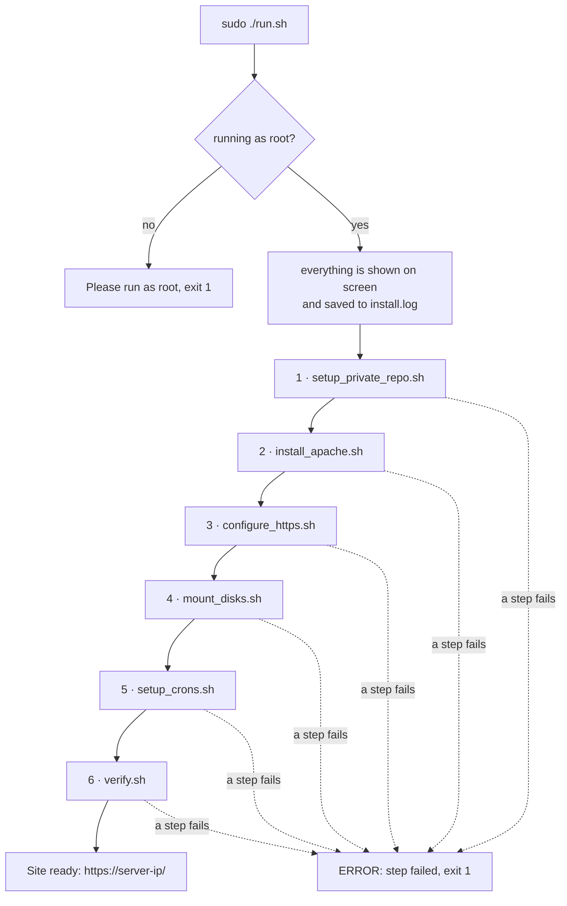
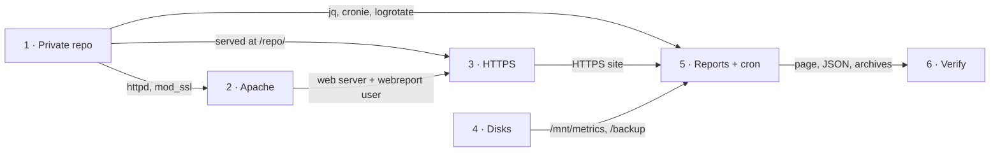
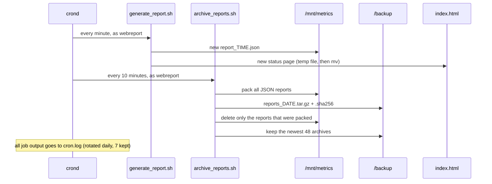
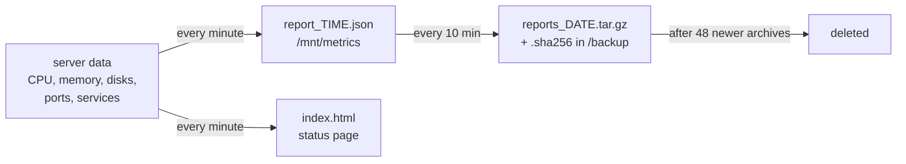
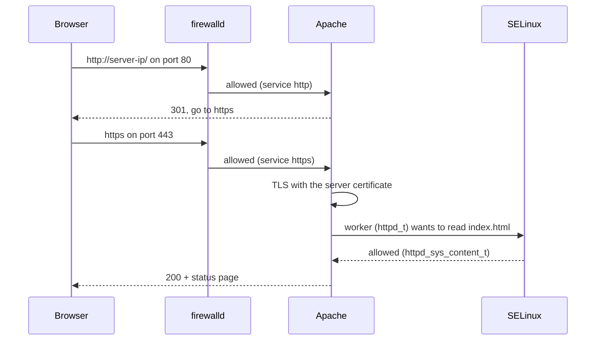
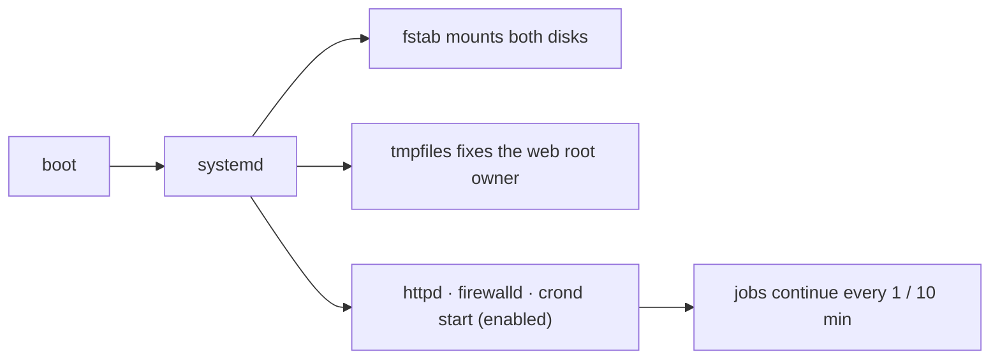
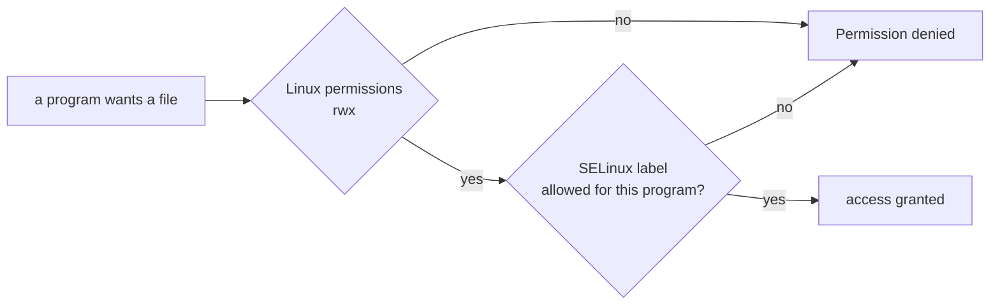

# The Self-Reporting Linux Server


One command turns a fresh **Rocky Linux / AlmaLinux / RHEL 9** machine into a web server that **reports on its own health** over HTTPS every minute, keeps a JSON copy of every report on its own disk, and archives them every 10 minutes. Every package comes from the server's **own signed private repository**, and nobody has to log in to fix anything by hand.

## Quick start

```bash
sudo dnf install -y git
git clone https://github.com/laith-iyad/linux-server-project.git
cd linux-server-project
sudo ./run.sh
```

Then open **`https://<server-ip>/`** in a browser. The certificate is self-signed, so the browser shows a warning the first time.

> [!NOTE]
> **Needs:** Rocky, AlmaLinux or RHEL 9 · `sudo` · internet on the first run (to fill the private repo) · about 2 GB of free disk space.
> `run.sh` is **safe to run again** at any time.

## What you get

- 📊 **A status page** at `https://<server-ip>/`, which rebuilds every minute and refreshes itself every 60 s
- 📦 **The private package repo** at `https://<server-ip>/repo/`
- 🧾 **A JSON report every minute** on its own disk → `/mnt/metrics`
- 🗄️ **A compressed, checksummed archive every 10 minutes** on a second disk → `/backup` (the last 48 = 8 hours)
- ✅ **`sudo ./verify.sh`**, a PASS / FAIL health check of the whole server

---

## How it works

### `run.sh`: one command, six steps



| Step | Script | What it does |
|---|---|---|
| 1 | `setup_private_repo.sh` | Downloads every package + its dependencies into `/var/www/repo`, builds the index, checks signatures with the distribution's GPG key, then **disables every other repo** |
| 2 | `install_apache.sh` | Installs Apache from the private repo and runs its workers as the small system user `webreport` |
| 3 | `configure_https.sh` | Self-signed certificate (renewed only when needed), HTTP → HTTPS redirect, `/repo/` published, firewall opened for web only |
| 4 | `mount_disks.sh` | Creates two image-file disks (512 MB metrics, 1 GB backup), formats them with XFS, and mounts them through `/etc/fstab` |
| 5 | `setup_crons.sh` | Installs the report and archive jobs as `webreport` in `/etc/cron.d`, with log rotation |
| 6 | `verify.sh` | Checks everything and prints PASS / FAIL; exits with an error if anything fails |

### How the steps feed each other



All settings live in **`config.sh`**, which every script loads, so no path or IP address is typed into the scripts themselves.

---

## Behind the scenes

### Every minute and every 10 minutes



### The life of one report



### What happens when someone opens the site



### After a reboot

Nothing has to be fixed by hand. Everything comes back by itself:



---

## Security

- **Signed packages only:** `gpgcheck=1` with the distribution's key, and `private-local` is the only enabled repo
- **Least privilege:** Apache workers and both jobs run as `webreport` (no password, no login shell); the job scripts in `/opt` are owned by root, so `webreport` can run them but not change them
- **SELinux stays Enforcing:** wrong labels are fixed with `restorecon`, never by turning SELinux off
- **firewalld stays on:** only `http` and `https` are opened
- **HTTPS:** RSA 2048 key with mode `600`; the certificate covers the hostname **and** the IP; Apache's version is hidden; directory listing is off except for `/repo/`
- **Private data:** both disks are mode `750`, owned by `webreport`; `cron.log` is mode `640`

Every file has to pass **two locks**:



---

## Safe to run again

Every step checks before it changes anything:

- packages already in the repo are skipped, and the official repos are switched on **only for the download**
- a new certificate is made only if one is missing, expires within 30 days, or the IP changed
- a disk that already has a filesystem is **never reformatted**
- an `fstab` line, a firewall rule or a user is added only if it's missing
- the cron and logrotate files are rewritten, so there are never duplicate jobs

## Configuration

Everything is in **`config.sh`**. Some useful settings:

```bash
PACKAGES=(httpd mod_ssl jq cronie logrotate)   # what the private repo holds
REPORT_SCHEDULE="* * * * *"                    # report: every minute
ARCHIVE_SCHEDULE="*/10 * * * *"                # archive: every 10 minutes
ARCHIVE_KEEP=48                                # archives to keep (8 hours)
METRICS_SIZE="512M"; BACKUP_SIZE="1G"          # disk sizes
VALID_DAYS=365; RENEW_DAYS=30                  # certificate life / renew window
REFRESH_SEC=60                                 # page auto-refresh
```

## Checking the server

```bash
sudo ./verify.sh
```

```text
PASS  only private-local is enabled
PASS  httpd installed from private-local
PASS  httpd enabled and running
...
PASS  newest archive exists and checksum matches
PASS  SELinux is Enforcing
Site ready: https://<server-ip>/
```

<details>
<summary><b>All 17 checks</b></summary>

- only `private-local` is enabled, and `httpd` was installed from it
- `httpd`, `firewalld` and `crond` are enabled and running
- Apache workers run as `webreport`
- `https://<host>/` returns 200 without `-k` · `http://<host>/` returns 301 · `/repo/repodata/repomd.xml` returns 200
- both disks are mounted and listed in `/etc/fstab`, and `findmnt --verify` passes
- `index.html` was updated in the last 3 minutes
- the newest archive exists and its checksum matches
- SELinux is Enforcing

</details>

<details>
<summary><b>Example JSON report</b></summary>

```json
{
  "time": "2026-11-24 18:15:01",
  "hostname": "project-dev",
  "os": "Rocky Linux 9.8 (Blue Onyx)",
  "load_average": "0.05 0.03 0.01",
  "cpu_percent": 1,
  "memory_percent": 34,
  "disk_percent": { "root": 18, "metrics": 7, "backup": 5 },
  "logged_in_users": 1,
  "listening_ports": [22, 80, 443, 9090],
  "top_processes": ["gnome-shell (5.6%)", "httpd (1.5%)"],
  "services": { "httpd": "active", "crond": "active", "firewalld": "active" },
  "archives": { "count": 12, "newest": "reports_2026-11-24_181000.tar.gz" }
}
```

</details>

<details>
<summary><b>Where things live on the server</b></summary>

- private repo → `/var/www/repo` · repo file → `/etc/yum.repos.d/private-local.repo`
- site config → `/etc/httpd/conf.d/linux-server-project.conf` · page → `/var/www/html/index.html`
- certificate → `/etc/pki/tls/certs/apache.crt` · key → `/etc/pki/tls/private/apache.key`
- disk images → `/var/lib/linux-server-project/` · mounted on `/mnt/metrics` and `/backup`
- jobs → `/opt/linux-server-project/` · cron → `/etc/cron.d/linux-server-project`
- logs → `/var/log/linux-server-project/install.log` and `cron.log`

</details>

## Troubleshooting

```bash
sudo tail -n 40 /var/log/linux-server-project/install.log    # what run.sh did
sudo tail -n 20 /var/log/linux-server-project/cron.log       # the jobs' output
sudo tail -n 20 /var/log/httpd/linux-server-project_error.log
sudo ausearch -m avc -ts recent                              # SELinux blocks
sudo ./verify.sh                                             # what is failing
```

## Repository layout

```text
.
├── README.md
├── run.sh                  # runs steps 1-6, logs to install.log
├── config.sh               # every setting + shared functions
├── setup_private_repo.sh   # step 1
├── install_apache.sh       # step 2
├── configure_https.sh      # step 3
├── mount_disks.sh          # step 4
├── setup_crons.sh          # step 5
├── generate_report.sh      # cron job: every minute
├── archive_reports.sh      # cron job: every 10 minutes
└── verify.sh               # step 6
```

## Red Hat family notes

- The GPG key is chosen automatically from `ID` in `/etc/os-release` (Rocky, AlmaLinux or RHEL); other systems stop with a clear message.
- The names of the official repos are saved on the first run, so re-runs can download again after those repos are disabled.
- On a subscribed RHEL machine, `subscription-manager` manages `redhat.repo` and may switch repos back on.

---

*LFS101 final project by Laith (Abu Iyad).*
